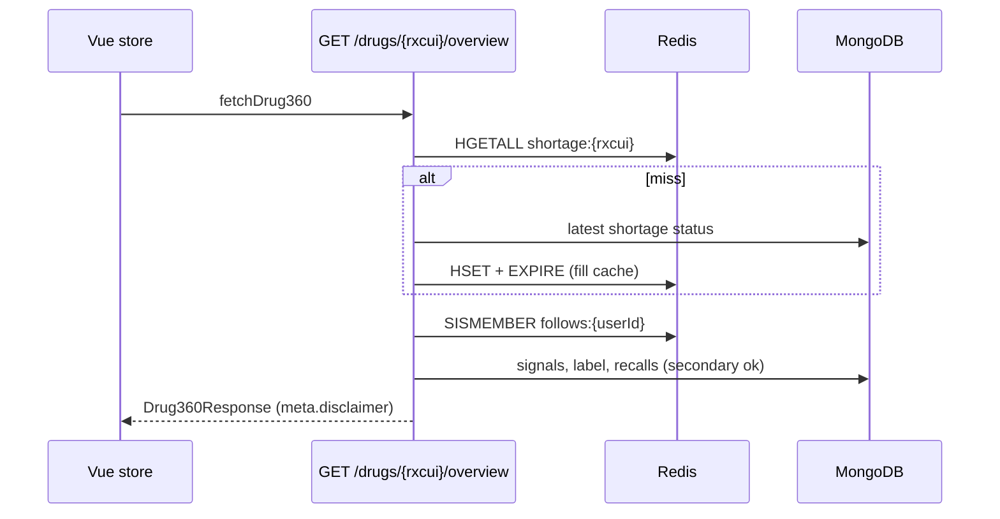
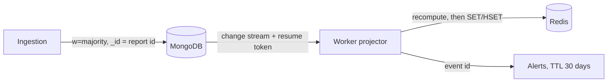

# MedSignal Backend

FastAPI service of **MedSignal v2** (drug safety and shortage intelligence). It cross-analyses openFDA FAERS adverse event
reports, DailyMed labels, openFDA shortages and recalls, and RxNorm names to provide early signal detection (PRR),
label-gap candidates, shortage substitution advice and personalised alerts.

> Reports are voluntary and unverified. They show a statistical signal, not proof of causation. Every signal and
> label-gap response carries a `meta.disclaimer` field (NFR-11).

## 1. Architecture

Clean / onion architecture with a single dependency rule: **dependencies point inward**.

| Layer | Folder | Responsibility | May import | Never imports |
|---|---|---|---|---|
| Domain | `app/domain` | Entities, value objects, business rules (PRR, CI lower bound, chi-square, emerging policy, label-gap matcher, alternative ranker). Pure Python. | nothing | everything else |
| Application | `app/application` | Use cases, ports (abstract contracts), DTOs (Pydantic). Orchestrates the domain. | domain, core | Motor, redis-py, httpx, FastAPI |
| Infrastructure | `app/infrastructure` | Adapters that implement the ports: MongoDB, Redis, external APIs, change-stream sync, scheduler. | application ports, domain, core | presentation |
| Presentation | `app/presentation` | FastAPI routers, request validation, authentication, error mapping. | application, core | infrastructure (except in `dependencies.py`) |
| Core | `app/core` | Settings, security helpers, constants. | - | - |

The only place that knows concrete adapters is `app/presentation/api/dependencies.py` (API process) and `app/worker.py` (worker process).
Ports are named by purpose (`ShortageStatusStore`, `FollowStore`), not by technology.

The backend runs as **two processes**: the API (`uvicorn app.main:app`) and the worker (`python -m app.worker`) that runs the daily shortage poll
and the MongoDB change-stream projector, so jobs never run once per API worker.

## 2. Folder structure

```
MedSignal-Backend/
├── app/
│   ├── main.py                      # App factory, lifespan, CORS, Swagger metadata
│   ├── worker.py                    # Separate process: scheduler + change-stream projector
│   ├── core/
│   │   ├── config.py                # Pydantic BaseSettings (.env)
│   │   ├── security.py              # bcrypt hashing, JWT (NFR-10)
│   │   └── constants.py             # Disclaimer text (NFR-11), alert TTL (NFR-09)
│   ├── domain/                      # Pure Python, no framework imports
│   │   ├── entities/                # drug, report, label, shortage, signal, user, alert
│   │   ├── value_objects/           # contingency_table, rxcui, quarter, reaction_term
│   │   ├── services/                # signal_calculator, emerging_signal_policy,
│   │   │                            # label_gap_matcher, alternative_ranker
│   │   └── exceptions.py
│   ├── application/
│   │   ├── ports/                   # report/signal/label/shortage/recall/drug/user/excluded_term/
│   │   │                            # ingestion_run repositories; shortage_status/follow/alert/counter
│   │   │                            # stores; drug_normalizer, external_data_source, clock
│   │   ├── use_cases/               # auth, drugs, signals, shortages, cabinet, profile,
│   │   │                            # ingestion, sync, admin
│   │   ├── services/alert_dispatcher.py
│   │   └── dtos/                    # Request/response models (become the Swagger schemas)
│   ├── infrastructure/
│   │   ├── mongodb/
│   │   │   ├── client.py            # Motor client, write concern majority, secondary reads
│   │   │   ├── indexes.py           # All indexes in one place
│   │   │   ├── repositories/        # One adapter per repository port
│   │   │   └── pipelines/           # signal_counts, pair_counts, stats_by_group
│   │   ├── redis/
│   │   │   ├── client.py            # Single node or Sentinel, chosen by config
│   │   │   ├── key_schema.py        # The only place where key strings are built
│   │   │   └── stores/              # shortage_status, follow, alert, counter
│   │   ├── external/                # openfda_client, rxnorm_client, dailymed_client
│   │   ├── sync/                    # change_stream_projector, checkpoint_store
│   │   └── scheduling/jobs.py       # Daily shortage poll (FR-28)
│   └── presentation/
│       └── api/
│           ├── router.py            # APIRouter aggregator
│           ├── routers/             # health, auth, drugs, signals, statistics, shortages, cabinet, profile
│           │   └── admin/           # ingestion, reports, labels, shortages, users,
│           │                        # excluded_terms, reconciliation
│           ├── dependencies.py      # DI providers, get_current_user, require_role
│           ├── error_handlers.py    # Domain exceptions to HTTP codes
│           └── responses.py         # not_implemented() helper for skeleton endpoints
├── tests/ {unit, integration, e2e}
├── scripts/                         # medsignal_api_check.py, download_faers.py, load_sample.py, benchmark_indexes.py
├── deploy/                          # docker-compose.local.yml, mongo/, redis/, virtual-lab/
├── .env.example  Dockerfile  requirements.txt  requirements-dev.txt  pytest.ini
```

The URL prefix `/api/v1` is set once in `app/main.py` (URL versioning); the folders are flat.

## 3. Functionalities and endpoints

Requirement IDs refer to the *Actors and Requirements* document. Roles: **Guest** (no token), **User** (JWT), **Admin** (JWT with role admin).

| Area | Endpoint (prefix `/api/v1`) | Requirement | Role |
|---|---|---|---|
| Health | `GET /health` | - | Guest |
| Auth | `POST /auth/register`, `POST /auth/login` | FR-11, FR-12 | Guest |
| Search | `GET /drugs?query=` (typo tolerant, normalised to RxCUI) | FR-01 | Guest |
| Drug 360 | `GET /drugs/{rxcui}/overview` | FR-02 | Guest (follow state needs login) |
| Trend | `GET /drugs/{rxcui}/reaction-trend` | FR-03 | Guest |
| Label gaps | `GET /drugs/{rxcui}/label-gaps` | FR-07 | Guest |
| Signals | `GET /signals` (filters: quarter, drug, reaction, min_reports) | FR-04, FR-05 | Guest |
| Emerging | `GET /signals/emerging` | FR-06 | Guest |
| Signal reports | `GET /signals/{rxcui}/{reaction}/reports` | FR-09 | Guest |
| Statistics | `GET /statistics` (age group, sex, country, seriousness over time) | FR-08 | Guest |
| Alternatives | `GET /shortages/{rxcui}/alternatives` (same route and form, not in shortage) | FR-10 | Guest |
| My medicines | `GET /cabinet`, `POST /cabinet/follows`, `DELETE /cabinet/follows/{rxcui}` | FR-15, FR-16 | User |
| Alerts | `GET /cabinet/alerts`, `DELETE /cabinet/alerts/{id}`, `DELETE /cabinet/alerts` | FR-17, FR-18 | User |
| Profile | `GET/PATCH/DELETE /profile`, `POST /profile/password`, `GET/PUT /profile/alert-settings` | FR-13, FR-14 | User |
| Ingestion | `POST /admin/ingestion/faers`, `POST /admin/ingestion/incremental`, `GET /admin/ingestion/runs` | FR-19, FR-20, FR-21 | Admin |
| Admin CRUD | `/admin/reports`, `/admin/labels`, `/admin/shortages`, `/admin/users` (list, create, read, update, delete) | FR-22 to FR-25 | Admin |
| Excluded terms | `GET/POST/DELETE /admin/excluded-terms` | FR-26 | Admin |
| Reconciliation | `POST /admin/reconciliation` | FR-27 | Admin |
| Background | Daily shortage poll (history), name normalisation at ingestion, signal recompute and alerts | FR-28, FR-29, FR-30 | System |

There is no admin screen in the UI: admin functions are used through Swagger (`/docs`).

## 4. Data layer

**MongoDB (document DB, replica set of 3)** - collections:

| Collection | Content |
|---|---|
| `reports` | FAERS reports with embedded drugs (raw and normalised RxCUI, role) and reactions |
| `labels` | DailyMed / openFDA labels per set id with sections and versions |
| `shortages` | Shortage status history (built by our own daily polling) |
| `signals` | Precomputed quarterly signals (PRR, CI lower, chi-square, novelty) |
| `recalls`, `drugs` | Recalls matched to drugs; drug dictionary (RxNorm cache) |
| `users`, `excluded_terms`, `ingestion_runs`, `sync_checkpoints` | Accounts, non-specific reaction terms, ingestion logs, change-stream resume token |

Indexes are defined in `infrastructure/mongodb/indexes.py` and must be justified with `explain()` before and after (`scripts/benchmark_indexes.py`).
Sharding candidate: hashed key on drug code or report id (never the date alone).

**Redis (key-value DB, primary + 2 replicas + Sentinel)** - keys built only in `infrastructure/redis/key_schema.py`:

| Key | Type | Purpose |
|---|---|---|
| `shortage:{rxcui}` | HASH | Live shortage status (millisecond lookups) |
| `follows:{userId}` / `followers:{rxcui}` | SET | Medicine cabinet, many-to-many in both directions |
| `alert:{userId}:{eventId}` | HASH, TTL 30 days | One alert; event id makes replays safe |
| `alerts:{userId}` | ZSET | Alert index by timestamp, pruned on read |
| `count:{rxcui}:{reaction}:{quarter}` | STRING | Live counter, overwritten after recomputation (never INCRBY) |

**Read path (cache-aside, Drug 360):**



**Write path (event sync):**



Replays are safe: documents are upserted by id, Redis values are overwritten, alerts are keyed by event id. If the resume token expires, `Reconcile` (FR-27) rebuilds Redis from MongoDB.

## 5. Tools

| Concern | Tool |
|---|---|
| Web framework, Swagger/OpenAPI | FastAPI, Uvicorn (`/docs`, `/openapi.json`) |
| DTOs and settings | Pydantic v2, pydantic-settings |
| Document DB | MongoDB 7 (replica set of 3) with Motor (async) |
| Key-value DB | Redis 7 (primary, 2 replicas, Sentinel) with redis-py asyncio |
| External data | httpx: openFDA, RxNorm/RxClass, DailyMed |
| Background jobs | APScheduler, MongoDB change streams |
| Security | bcrypt (hashing), PyJWT (tokens), role checks per endpoint |
| Tests | pytest, pytest-asyncio, FastAPI TestClient |
| Deployment | Docker, Docker Compose |

No managed services (Upstash, Atlas) are used: the brief requires 3 + 3 replicas on a local cluster and on the UNIPI Virtual Lab.

## 6. Configuration

Copy `.env.example` to `.env`.

| Variable | Meaning |
|---|---|
| `MONGO_URI`, `MONGO_DB` | Host-run API: `mongodb://localhost:27017/?directConnection=true`. Inside compose or on the lab: `mongodb://mongo1:27017,mongo2:27017,mongo3:27017/?replicaSet=rs0` |
| `REDIS_URL` | Single Redis node (development) |
| `REDIS_SENTINELS`, `REDIS_MASTER_NAME` | `host:26379,host:26379,host:26379` and `mymaster`; when set, Sentinel is used instead of `REDIS_URL` |
| `JWT_SECRET`, `JWT_EXPIRE_MINUTES` | Token signing (use a long random secret outside development) |
| `CORS_ORIGINS` | Allowed frontend origins |
| `OPENFDA_API_KEY` | Optional free key |

## 7. Run and test

```bash
python -m venv .venv && . .venv/bin/activate        # Windows: .venv\Scripts\activate
pip install -r requirements-dev.txt
cp .env.example .env
docker compose -f deploy/docker-compose.local.yml up -d     # MongoDB x3, Redis x3, Sentinels
uvicorn app.main:app --reload                               # http://localhost:8000/docs
python -m app.worker                                        # second terminal, when implemented
python -m pytest                                            # 9 tests
```

Everything in containers (databases, API, worker, frontend at http://localhost:8080):
`docker compose -f deploy/docker-compose.local.yml --profile app up -d --build`.

Tests: `tests/unit` (PRR reproduces 4.87 / CI 4.48 / chi-square about 1609 for ibuprofen + GI haemorrhage, key schema, security),
`tests/integration` (OpenAPI paths, 501 stubs, admin needs auth), `tests/e2e` (to be written against the compose databases).

## 8. Deployment on the UNIPI Virtual Lab

1. One VM per replica: each runs one `mongod` and one Redis (primary on VM1, replicas on VM2 and VM3) plus a Sentinel, using `deploy/virtual-lab/docker-compose.node.yml` with `NODE_IP` and `VM1_IP` set in `.env`.
2. Initiate the MongoDB replica set once from VM1: `deploy/virtual-lab/init-replica-lab.sh VM1_IP VM2_IP VM3_IP`.
3. Run the API, the worker and the Nginx frontend image on VM1 (or a fourth VM) with `MONGO_URI` listing the three members and `REDIS_SENTINELS` listing the three Sentinels.
4. Load a sample of FAERS (`scripts/download_faers.py`, `scripts/load_sample.py`) to fit the lab resources.

The `virtual-lab` files are an untested template: confirm ports and networking with the instructors.

## 9. State of the skeleton

- **Working:** app factory, Swagger with all planned endpoints and schemas, `GET /health`, JWT and role dependencies, Redis key schema and the four Redis stores, PRR calculator, index definitions, pair-count pipeline, `GetDrug360` (cache-aside reference), compose files.
- **Stubs** (HTTP 501 or `NotImplementedError`): all other use cases, MongoDB repositories, external API clients, change-stream projector, scheduled job body, pipelines 2 and 3.

## 10. How to add a feature

1. Add or reuse a DTO in `application/dtos`.
2. Write the use case in `application/use_cases/<area>/` using ports only.
3. Implement the missing port methods in `infrastructure/mongodb/repositories` or `infrastructure/redis/stores`.
4. Wire the use case in `presentation/api/dependencies.py` and call it from the router.
5. Add a unit test for the domain rule and an integration test for the endpoint.
