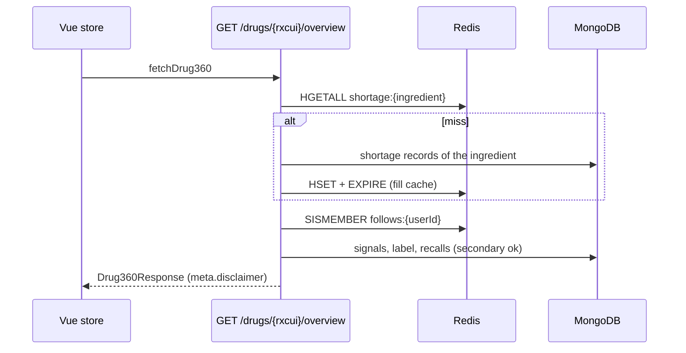
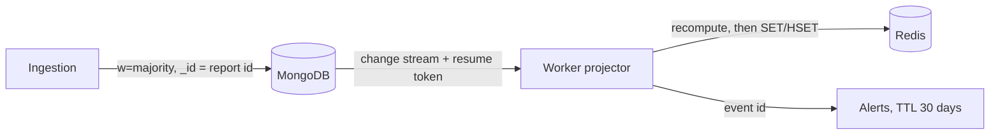

# MedSignal Backend

FastAPI service of **MedSignal v2** (drug safety and shortage intelligence). It cross-analyses openFDA FAERS adverse event
reports, DailyMed / openFDA labels, openFDA shortages and recalls, and RxNorm names to provide early signal detection (PRR),
label-gap candidates, shortage substitution advice and personalised alerts.

> Reports are voluntary and unverified. They show a statistical signal, not proof of causation. Every signal and
> label-gap response carries a `meta.disclaimer` field (NFR-11).

## Contents

1. [Architecture](#1-architecture)
2. [Folder structure](#2-folder-structure)
3. [The clean data model](#3-the-clean-data-model)
4. [Signal computation](#4-signal-computation)
5. [Functionalities and endpoints](#5-functionalities-and-endpoints)
6. [Data layer](#6-data-layer)
7. [Tools](#7-tools)
8. [Configuration](#8-configuration)
9. [Run and test](#9-run-and-test)
10. [Handoff to the database adapters](#10-handoff-to-the-database-adapters-phases-4-5)
11. [Deployment on the UNIPI Virtual Lab](#11-deployment-on-the-unipi-virtual-lab)
12. [State of the backend](#12-state-of-the-backend)
13. [How to add a feature](#13-how-to-add-a-feature)

## 1. Architecture

Clean / onion architecture with a single dependency rule: **dependencies point inward**.

| Layer | Folder | Responsibility | May import | Never imports |
|---|---|---|---|---|
| Domain | `app/domain` | Entities (Pydantic models), value objects, business rules: PRR, CI lower bound, chi-square, emerging policy, label-gap matcher, alternative ranker, shortage diff, date / NDC / name parsers. No I/O. | pydantic only | everything else |
| Application | `app/application` | Use cases, **ports** (abstract contracts named by purpose), the pure **transformers** (raw source record -> clean model), DTOs (Pydantic, they become the Swagger schemas), the container of ports. | domain, core | pymongo, redis-py, httpx, FastAPI |
| Infrastructure | `app/infrastructure` | Adapters that implement the ports: in-memory reference adapters, MongoDB, Redis, external clients, change-stream sync, scheduler. | application ports, domain, core | presentation |
| Presentation | `app/presentation` | FastAPI routers, request validation, authentication, error mapping. | application, core | infrastructure (except `dependencies.py`) |
| Core | `app/core` | Settings, security helpers, constants. | - | - |

The only places that know concrete adapters are `app/infrastructure/container_factory.py` (chooses the adapters),
`app/presentation/api/dependencies.py` (builds use cases per request) and `app/worker.py`.
Ports are named by purpose (`ShortageStatusStore`, `FollowStore`), not by technology.

The backend runs as **two processes**: the API (`uvicorn app.main:app`) and the worker (`python -m app.worker`) with the daily
shortage poll and, later, the MongoDB change-stream projector, so jobs never run once per API worker.

**Two storage backends behind the same ports** (`STORAGE_BACKEND`):

| Value | What it is | Use |
|---|---|---|
| `memory` | Reference adapters over JSON Lines files in `DATA_DIR` (`data/clean/*.jsonl`) | Runs the whole API with real data and **no databases**. Defines the behaviour the database adapters must reproduce. |
| `databases` | MongoDB + Redis adapters (`app/infrastructure/database_container.py`, written by the team) | Course deliverable: 3 replicas each, local and Virtual Lab. |

## 2. Folder structure

`[TEAM]` marks what the database team writes (phases 4-5); everything else exists and is tested.

```
MedSignal-Backend/
├── app/
│   ├── main.py                      # App factory, lifespan (builds the container), CORS, Swagger metadata
│   ├── worker.py                    # Separate process: scheduler (+ change-stream projector [TEAM])
│   ├── core/
│   │   ├── __init__.py
│   │   ├── config.py                # Pydantic BaseSettings (.env), incl. STORAGE_BACKEND, DATA_DIR, CACHE_DIR
│   │   ├── security.py              # bcrypt hashing, JWT (NFR-10)
│   │   └── constants.py             # Disclaimer text (NFR-11), alert TTL (NFR-09), API_PREFIX
│   ├── domain/                      # Pure Python (+ pydantic), no framework imports
│   │   ├── entities/                # drug, rx_concept, product, label, shortage, recall, report, name_mapping,
│   │   │                            # signal, alert, user, ingestion_run, excluded_term, enums
│   │   ├── value_objects/           # rxcui, ndc (to_ndc11), unii, set_id, quarter, reaction_term,
│   │   │                            # contingency_table, pair_counts
│   │   ├── services/                # signal_calculator, emerging_signal_policy, label_gap_matcher,
│   │   │                            # alternative_ranker, shortage_diff, shortage_summary, date_parser,
│   │   │                            # code_dictionary, age_bucketer, drug_name_cleaner, label_text_union
│   │   └── exceptions.py
│   ├── application/
│   │   ├── container.py             # The container of ports handed to the use cases
│   │   ├── ports/                   # report/signal/label/shortage/recall/drug/user/excluded_term/ingestion_run
│   │   │                            # repositories; shortage_status/follow/alert/counter stores;
│   │   │                            # drug_normalizer, external_data_source, clock (19 ports)
│   │   ├── ingestion/transformers/  # report, shortage, ndc_product, label, recall, rxnorm (raw -> clean, pure)
│   │   ├── services/                # ingredient_resolver, alert_dispatcher
│   │   ├── use_cases/
│   │   │   ├── auth/                # login, register
│   │   │   ├── drugs/               # search_drug, get_drug_360, get_reaction_trend, get_label_gaps
│   │   │   ├── signals/             # list_signals, emerging_signals, signal_reports, statistics
│   │   │   ├── shortages/           # recommend_alternatives
│   │   │   ├── cabinet/             # follow_drug, unfollow_drug, list_followed, list_alerts, dismiss_alert
│   │   │   ├── profile/             # profile and alert settings (get, update, delete, change password)
│   │   │   ├── ingestion/           # load_faers_bulk, poll_shortages, update_labels_recalls, link_recalls,
│   │   │   │                        # compute_quarter_signals, build_clean_dataset, list_ingestion_runs
│   │   │   ├── sync/                # project_change_event, reconcile
│   │   │   └── admin/               # manage_excluded_terms (crud_* stubs: labels, reports, shortages, users)
│   │   └── dtos/                    # admin, auth, cabinet, common, drugs, profile, shortages, signals
│   ├── infrastructure/
│   │   ├── clock.py
│   │   ├── container_factory.py     # Picks memory or databases from STORAGE_BACKEND
│   │   ├── database_container.py    # [TEAM] builds the Mongo + Redis adapters
│   │   ├── memory/                  # Reference adapters: repositories, stores, dataset (JSONL), factory
│   │   ├── mongodb/                 # [TEAM]
│   │   │   ├── client.py            # PyMongo async client, write concern majority, secondary reads
│   │   │   ├── indexes.py           # All indexes in one place
│   │   │   ├── repositories/        # One adapter per repository port (drug, excluded_term, ingestion_run,
│   │   │   │                        # recall, report, shortage, signal, user, label, ...)
│   │   │   └── pipelines/           # signal_counts, pair_counts, stats_by_group
│   │   ├── redis/                   # [TEAM]
│   │   │   ├── client.py            # Single node or Sentinel, chosen by config
│   │   │   ├── key_schema.py        # The only place where key strings are built
│   │   │   └── stores/              # shortage_status, follow, alert, counter
│   │   ├── external/                # http (retry, backoff, rate limit), openfda_client, rxnorm_client,
│   │   │                            # rxnorm_normalizer (disk cache), dailymed_client, file_feeds
│   │   ├── sync/                    # [TEAM] change_stream_projector, checkpoint_store
│   │   └── scheduling/              # jobs.py: daily shortage poll (FR-28)
│   └── presentation/
│       └── api/
│           ├── router.py            # APIRouter aggregator
│           ├── routers/             # health, auth, drugs, signals, statistics, shortages, cabinet, profile
│           │   └── admin/           # crud_factory, excluded_terms, ingestion, reconciliation
│           ├── dependencies.py      # DI providers, get_current_user, require_role
│           ├── error_handlers.py    # Domain exceptions to HTTP codes
│           └── responses.py         # not_implemented() helper for 501 endpoints
├── tests/
│   ├── fixtures/                    # raw.py (real-shaped source records), fakes.py
│   ├── unit/                        # domain, transformers, pipeline, infrastructure,
│   │                                # test_signal_calculator, test_key_schema, test_security
│   ├── integration/                 # test_api.py, dataset round trip
│   ├── conformance/                 # test_port_contract.py: every storage adapter must pass it
│   └── e2e/                         # to be written against the compose databases
├── scripts/
│   ├── download_raw.py              # shortages, NDC, labels, recalls -> data/raw
│   ├── download_faers.py            # FAERS partitions
│   ├── build_clean_dataset.py       # raw -> data/clean/*.jsonl (+ build report)
│   ├── load_sample.py               # load a sample into the databases
│   ├── benchmark_indexes.py         # explain() before/after indexes
│   └── medsignal_api_check.py       # live API sanity checks
├── deploy/
│   ├── docker-compose.local.yml     # MongoDB x3, Redis x3, Sentinels (+ `app` profile)
│   ├── mongo/init-replica.sh
│   ├── redis/sentinel.conf
│   └── virtual-lab/                 # docker-compose.node.yml, init-replica-lab.sh
├── docs/PORT_CONTRACT.md            # Contract for the database adapters
├── .env.example  Dockerfile  requirements.txt  requirements-dev.txt  pytest.ini  .gitignore  README.md
```

The URL prefix `/api/v1` is set once in `app/main.py` (URL versioning); the folders are flat.

## 3. The clean data model

The profile of the real endpoints (schema report of 10 Nov 2026) drives the model. Source quirks are removed in the
transformers so nothing downstream knows about them.

| Source quirk | Handling |
|---|---|
| Codes as strings (`"1"`, `"048"`) | Enums for the meaningful ones; route codes stay strings (leading zero) |
| Five date formats | `parse_date` returns the date and its precision (`20240101`, `202212`, `2023`, `07/14/2023`, `01-MAY-26`, `Nov 09, 2026`) |
| `openfda` block missing or `{}` | Treated as "not harmonised"; the block is never stored, only ids and the match method |
| FAERS `reportduplicate` array or object | `normalize_reportduplicate` |
| NDC with 4-4-2, 5-3-2, 5-4-1 shapes | `Ndc.to_ndc11()` pads each segment; RxNav 11-digit codes compare equal |
| Empty strings and `N/A` | `None` |
| Typos (`Unvailable`, `Limited Availalbility`) | `normalize_availability` |
| Reaction terms in mixed case | Upper case everywhere (`normalize_reaction`) |
| `ST MARY^S THISTLE`, `A\B` substances, `UNSPECIFIED INGREDIENT` | `drug_name_cleaner` |
| Label arrays and `*_table` HTML | Joined text; tables dropped; warnings sections unioned |

**Ingredient is the hub.** Reports use product-level RxCUIs (SCD/SBD), but follows, signals and alerts hang on the ingredient
(RxNorm TTY `IN`). `IngredientResolver` maps product -> ingredient through RxNav and caches every answer.

**Name resolution** (`NameMapping`, auditable; methods HARMONIZED / EXACT / APPROXIMATE / UNMATCHED): harmonised rxcui first;
otherwise `activesubstancename`, then `medicinalproduct`. HARMONIZED and EXACT matches feed signals; APPROXIMATE matches are stored
as candidates and **never feed signals** until a person accepts them. Recalls follow the same idea (`RecallLink`:
ACCEPTED / CANDIDATE / UNREVIEWED): only 14% carry ids, the rest are linked by candidate text matching and stay unaccepted.

**Entities** (all Pydantic models in `domain/entities`): `Drug` (ingredient), `RxConcept`, `Product` (+ embedded `Package`),
`DrugLabel` (sections as text + version history), `ShortageRecord` / `ShortageEvent` / `ShortageSummary`, `Recall` + `RecallLink`,
`AdverseReport` (embedded reactions and drugs; only the highest version of a case is kept), `NameMapping`, `SafetySignal`
(keeps the 2x2 counts), `Alert`, `User`, `IngestionRun`, `ExcludedTerm`.
Drug role in a report: SUSPECT / CONCOMITANT / INTERACTING / OTHER (`drugcharacterization` 4, "drug not administered", maps to OTHER and is never suspect).

## 4. Signal computation

`ComputeQuarterSignals` asks the report repository for `PairCounts` (total reports, reports per drug, per reaction, per pair), then
builds every table with arithmetic only:

```
a = reports with drug and reaction          b = reports with the drug, without the reaction
c = reports with the reaction, other drugs  d = everything else
PRR = [a/(a+b)] / [c/(c+d)]    CI lower = exp(ln PRR - 1.96 SE)    chi-square on the 2x2 table
signal = Evans criteria (PRR >= 2, chi-square >= 4, a >= 3)     emerging = PRR >= 1.5 x average of the previous quarters
```

Reference check (unit test): ibuprofen + GI haemorrhage reproduces PRR 4.87 / CI lower 4.48 / chi-square about 1609.

Decisions where the plan left questions: the quarter is the calendar quarter of `receivedate`; the default role filter is
`SUSPECT`; the universe is every report of the quarter (also those without a resolved drug); excluded terms (FR-26) leave
the counts; `label_match` is FULL / PARTIAL / NONE against adverse reactions + warnings + boxed warning of the Rx labels.
Every list response returns `match_coverage`, the share of reports whose drugs were resolved, so the UI can show how much data stands behind a number.

## 5. Functionalities and endpoints

Prefix `/api/v1`. Requirement IDs refer to the *Actors and Requirements* document. Roles: **Guest** (no token), **User** (JWT), **Admin** (JWT with role admin).

| Area | Endpoint | Requirement | Role | State |
|---|---|---|---|---|
| Health | `GET /health` | - | Guest | works |
| Auth | `POST /auth/register`, `POST /auth/login` | FR-11, FR-12 | Guest | works |
| Search | `GET /drugs?query=` (typo tolerant, normalised to RxCUI) | FR-01 | Guest | works |
| Drug 360 | `GET /drugs/{rxcui}/overview?dosage_form=&route=` | FR-02 | Guest (follow state needs login) | works |
| Trend | `GET /drugs/{rxcui}/reaction-trend` | FR-03 | Guest | works |
| Label gaps | `GET /drugs/{rxcui}/label-gaps` | FR-07 | Guest | works |
| Signals | `GET /signals` (quarter, rxcui, reaction, min_reports) | FR-04, FR-05 | Guest | works |
| Emerging | `GET /signals/emerging` | FR-06 | Guest | works |
| Signal reports | `GET /signals/{rxcui}/{reaction}/reports` | FR-09 | Guest | works |
| Statistics | `GET /statistics?group_by=` (age group, sex, country, seriousness over time) | FR-08 | Guest | works |
| Alternatives | `GET /shortages/{rxcui}/alternatives` (same route and form, not in shortage) | FR-10 | Guest | works |
| My medicines | `GET /cabinet`, `POST /cabinet/follows`, `DELETE /cabinet/follows/{rxcui}` | FR-15, FR-16 | User | works |
| Alerts | `GET /cabinet/alerts`, `DELETE /cabinet/alerts[/{id}]` | FR-17, FR-18 | User | works |
| Profile | `GET/PATCH/DELETE /profile`, `POST /profile/password`, `GET/PUT /profile/alert-settings` | FR-13, FR-14 | User | works |
| Ingestion logs | `GET /admin/ingestion/runs` | FR-21 | Admin | works |
| Excluded terms | `GET/POST/DELETE /admin/excluded-terms` | FR-26 | Admin | works |
| Reconciliation | `POST /admin/reconciliation` | FR-27 | Admin | works (shortage summaries) |
| Ingestion triggers | `POST /admin/ingestion/faers`, `/incremental` | FR-19, FR-20 | Admin | 501: use the scripts or the worker |
| Admin CRUD | `/admin/reports`, `/labels`, `/shortages`, `/users` (list, create, read, update, delete) | FR-22 to FR-25 | Admin | 501 stub |
| Background | Daily shortage poll with history, name normalisation at ingestion, signal recompute and alerts | FR-28 to FR-30 | System | use cases done; worker polls shortages |

There is no admin screen in the UI: admin functions are used through Swagger (`/docs`).

## 6. Data layer

**MongoDB (document DB, replica set of 3)** - collections (shapes: `app/domain/entities`):

| Collection | Content |
|---|---|
| `reports` | Compact FAERS reports: embedded `reactions` and `drugs` (ids + match method), derived `reaction_pts`, `suspect_ingredient_ids`, `all_ingredient_ids`, `quarter` |
| `ingredients`, `rx_concepts` | Drug hub (RxNorm IN) with brands and ATC classes; product rxcui -> ingredient cache |
| `products` | NDC products with embedded packages (`ndc11`) |
| `labels` | One document per set id: text sections + version history |
| `shortages`, `shortage_events` | Current state per package NDC; our own change history (daily snapshot diff: APPEARED / DISAPPEARED / STATUS_CHANGE) |
| `recalls` | Recalls with their explicit `link` (ACCEPTED / CANDIDATE / UNREVIEWED) |
| `name_map` | Auditable name -> ingredient resolutions with candidates |
| `signals` | Quarterly PRR, CI lower, chi-square and the 2x2 counts, `is_signal`, `is_emerging`, `label_match` |
| `users`, `excluded_terms`, `ingestion_runs`, `sync_checkpoints` | Accounts, FR-26 terms, FR-21 logs, change-stream resume token |

Indexes are defined in `infrastructure/mongodb/indexes.py` and must be justified with `explain()` before and after (`scripts/benchmark_indexes.py`).
Suggested indexes are in `docs/PORT_CONTRACT.md`. Sharding candidate: hashed key on ingredient id or report id (never the date alone).

**Redis (key-value DB, primary + 2 replicas + Sentinel)** - keys built only in `infrastructure/redis/key_schema.py`, **keyed by ingredient rxcui**:

| Key | Type | Purpose |
|---|---|---|
| `shortage:{ingredient}` | HASH | `ShortageSummary`: worst status, packages in shortage / total, dosage forms (millisecond lookups) |
| `follows:{userId}` / `followers:{ingredient}` | SET | Medicine cabinet, many-to-many in both directions |
| `alert:{userId}:{alertId}` | HASH, TTL 30 days | One alert; the id is deterministic (`TYPE:ingredient:event`) so replays are safe |
| `alerts:{userId}` | ZSET | Alert index by timestamp, pruned on read |
| `count:{ingredient}:{reaction}:{quarter}` | STRING | Live counter, overwritten after a recount (never `INCRBY`) |

**Read path (cache-aside, Drug 360):** `GetDrug360` reads the `ShortageSummary` from the key-value store; on a miss it computes it from the
documents and fills the cache with a TTL.



**Write path (event sync):** ingestion writes the documents, the projector overwrites the live values and creates alerts keyed by event id.



Replays are safe: documents are upserted by id, Redis values are overwritten, alerts are keyed by event id. If the resume token
expires, `Reconcile` (FR-27) rebuilds the live layer from MongoDB.

## 7. Tools

| Concern | Tool |
|---|---|
| Web framework, Swagger/OpenAPI | FastAPI, Uvicorn (`/docs`, `/openapi.json`) |
| Models, DTOs, settings | Pydantic v2, pydantic-settings |
| Document DB | MongoDB 7 (replica set of 3). Driver: PyMongo async API (Motor is end-of-life); either works behind the ports |
| Key-value DB | Redis 7 (primary, 2 replicas, Sentinel) with redis-py asyncio |
| External data | httpx with retry, backoff and rate limit: openFDA, RxNav / RxClass, DailyMed |
| Background jobs | APScheduler, MongoDB change streams |
| Security | bcrypt (hashing), PyJWT (tokens), role checks per endpoint |
| Tests | pytest, pytest-asyncio, FastAPI TestClient, httpx MockTransport, fakeredis |
| Deployment | Docker, Docker Compose |

No managed services (Upstash, Atlas) are used: the brief requires 3 + 3 replicas on a local cluster and on the UNIPI Virtual Lab.

## 8. Configuration

Copy `.env.example` to `.env`.

| Variable | Meaning |
|---|---|
| `STORAGE_BACKEND` | `memory` (JSONL in `DATA_DIR`, no databases) or `databases` (Mongo + Redis) |
| `DATA_DIR`, `CACHE_DIR` | Clean dataset folder (default `data/clean`); RxNav disk cache |
| `MONGO_URI`, `MONGO_DB` | Host-run API: `mongodb://localhost:27017/?directConnection=true`. Inside compose or on the lab: `mongodb://mongo1:27017,mongo2:27017,mongo3:27017/?replicaSet=rs0` |
| `REDIS_URL` | Single Redis node (development) |
| `REDIS_SENTINELS`, `REDIS_MASTER_NAME` | `host:26379,host:26379,host:26379` and `mymaster`; when set, Sentinel is used instead of `REDIS_URL` |
| `JWT_SECRET`, `JWT_EXPIRE_MINUTES` | Token signing (use a random secret of at least 32 characters outside development) |
| `CORS_ORIGINS` | Allowed frontend origins |
| `OPENFDA_API_KEY` | Optional free key (higher rate limit) |

## 9. Run and test

```bash
python -m venv .venv && . .venv/bin/activate        # Windows: .venv\Scripts\activate
pip install -r requirements-dev.txt
cp .env.example .env
python -m pytest                                    # 69 tests, no network and no databases needed
uvicorn app.main:app --reload                       # http://localhost:8000/docs  (empty until data/clean exists)
python -m app.worker                                # second terminal: daily shortage poll
```

With databases (`STORAGE_BACKEND=databases`, once the team adapters exist):

```bash
docker compose -f deploy/docker-compose.local.yml up -d     # MongoDB x3, Redis x3, Sentinels
```

Everything in containers (databases, API, worker, frontend at http://localhost:8080):
`docker compose -f deploy/docker-compose.local.yml --profile app up -d --build`.

**Build the real dataset.** Needs network the first time; RxNav answers are cached in `CACHE_DIR`:

```bash
python -m scripts.download_raw --out data/raw --ndc 20000 --labels 5000 --recalls 20000    # shortages, NDC, labels, recalls
python -m scripts.download_faers ...                                                      # FAERS partitions
python -m scripts.build_clean_dataset --raw-dir data/raw --faers "data/faers/*.json" --out data/clean --link-recalls
```

The script prints the build report (records loaded and skipped, match rates, signals per quarter) and the total size of the clean
dataset: the brief asks for at least 50-100 MB. `STORAGE_BACKEND=memory uvicorn app.main:app` then serves everything from `data/clean`.

**Tests**

| Folder | Content |
|---|---|
| `tests/unit` | Domain rules and PRR (4.87 / 4.48 / about 1609), transformers on every source shape, pipeline, external clients with a mock transport, key schema, security |
| `tests/integration` | OpenAPI paths, the API over a synthetic dataset, role protection of the admin area, dataset round trip |
| `tests/conformance` | `test_port_contract.py`: every storage adapter must pass it (`ADAPTERS`) |
| `tests/e2e` | To be written against the compose databases |

What the tests prove: the 2x2 counts and PRR of a synthetic world to the unit, cache-aside and idempotent event handling (a replayed
shortage poll creates no new alerts), alerts expiring after 30 days, typo tolerant search.
Note: the old `tests/integration/test_api_skeleton.py` asserted HTTP 501 on use cases that now work; remove those assertions (only the admin CRUD and ingestion triggers stay 501).

## 10. Handoff to the database adapters (phases 4-5)

The MongoDB and Redis adapters are not part of this work. They implement the same ports and must pass `tests/conformance`.
See `docs/PORT_CONTRACT.md` (method contracts, `_id` mapping, suggested indexes, the `pair_counts` pipeline, Redis key changes).

Checklist:
1. Implement the repositories in `infrastructure/mongodb/repositories` and the pipelines in `infrastructure/mongodb/pipelines`.
2. Change the Redis stores and `key_schema.py` to ingredient-keyed keys and the `ShortageSummary` hash (section 6).
3. Build the container in `app/infrastructure/database_container.py` and register it in `container_factory.py` and in `ADAPTERS` of `tests/conformance/test_port_contract.py`.
4. Merge the new settings into `config.py` and the lifespan of `main.py`.
5. Delete from the repo what the overlay replaces: `ports/drug_repository.py`, `ports/signal_calculator.py` (use the domain service) and the misplaced `use_cases/profile/{list_ingestion_runs,load_faers_bulk,update_labels_recalls,poll_shortages}.py`.
6. Run the conformance suite, then `scripts/benchmark_indexes.py`.

## 11. Deployment on the UNIPI Virtual Lab

1. One VM per replica: each runs one `mongod` and one Redis (primary on VM1, replicas on VM2 and VM3) plus a Sentinel, using `deploy/virtual-lab/docker-compose.node.yml` with `NODE_IP` and `VM1_IP` set in `.env`.
2. Initiate the MongoDB replica set once from VM1: `deploy/virtual-lab/init-replica-lab.sh VM1_IP VM2_IP VM3_IP`.
3. Run the API, the worker and the Nginx frontend image on VM1 (or a fourth VM) with `MONGO_URI` listing the three members and `REDIS_SENTINELS` listing the three Sentinels.
4. Load `data/clean/*.jsonl` with `mongoimport` or the loader of the database container (`scripts/load_sample.py`); keep the dataset sample small enough for the lab resources.

The `virtual-lab` files are an untested template: confirm ports and networking with the instructors.

## 12. State of the backend

| Area | State |
|---|---|
| Domain model, parsers, PRR / CI / chi-square, label-gap matcher, ranker, shortage diff | Done, tested |
| Transformers for reports, shortages, NDC, labels, recalls, RxNav answers | Done, tested on the real shapes |
| Ingredient resolver (cache, EXACT vs candidate rule), recall linking | Done, tested |
| Use cases: search, Drug 360, trend, label gaps, signals, emerging, statistics, alternatives, auth, cabinet, profile, excluded terms | Done, tested |
| Ingestion use cases: FAERS load, shortage poll with history and alerts, labels and recalls update, signal computation, dataset builder | Done, tested with fakes |
| In-memory reference adapters + JSONL dataset, conformance suite | Done |
| External clients with retry and rate limit, RxNav disk cache | Done, tested with a mock transport; **not run against the live APIs** |
| MongoDB adapters, aggregation pipelines, indexes, Redis stores, change-stream projector | Team (phases 4-5) |
| Admin CRUD, ingestion triggers over HTTP | 501 stubs |
| Compose files, `virtual-lab` template | Compose works locally; `virtual-lab` untested |
| Run on the real raw data (size, match rates, signal sanity) | **To do: run `scripts.build_clean_dataset` on the real downloads** |

Open questions: the UNII -> RxCUI lookup route of RxNav (client method exists, marked unverified), the exact RxNav behaviour for
combination products, and whether the quarter should follow the FDA file quarter instead of `receivedate` (one function to change: `Quarter.from_date`).

## 13. How to add a feature

1. Add or reuse a DTO in `application/dtos`.
2. If a new source shape is involved, add a pure transformer in `application/ingestion/transformers` with a test on a real-shaped record.
3. Write the use case in `application/use_cases/<area>/` using ports only.
4. Implement the missing port methods in the in-memory adapters first (`infrastructure/memory`), add the case to `tests/conformance`, then in `infrastructure/mongodb/repositories` or `infrastructure/redis/stores`.
5. Wire the use case in `presentation/api/dependencies.py` and call it from the router.
6. Add a unit test for the domain rule and an integration test for the endpoint.
