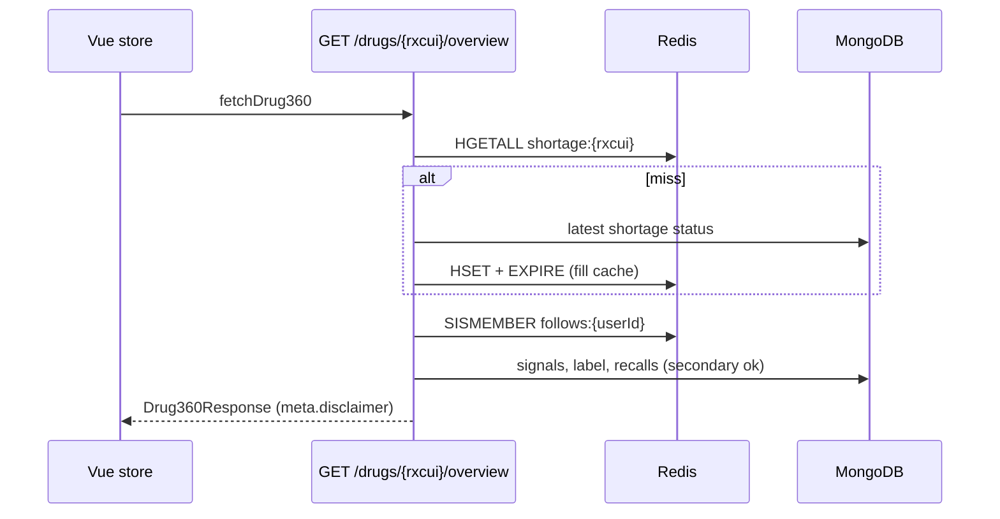
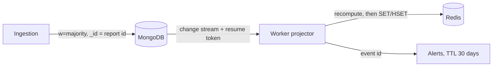

# Architecture

## Layers

| Layer | Imports | Never imports |
|---|---|---|
| domain | nothing | everything else |
| application | domain, core | Motor, redis-py, httpx, FastAPI |
| infrastructure | application ports, domain, core | presentation |
| presentation | application, core | infrastructure (except in `dependencies.py`) |

## Read path: cache-aside (Drug 360)

## Write path: event sync

Replays are safe: documents are upserted by id, Redis values are overwritten, alerts are keyed by event id.
If the resume token expires, `Reconcile` (FR-27) rebuilds Redis from MongoDB.
